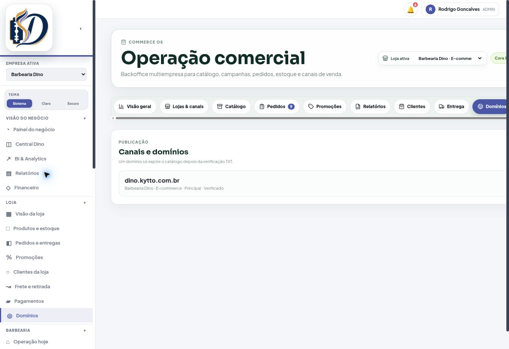

# Dino — auditoria e correções de 28/09/2026

## Resultado e limites

A loja pública foi acessada em https://dino.kytto.com.br e os fluxos abaixo foram exercitados no navegador. O código foi obtido pelo conector GitHub, fixado no commit `ef74e2419de0ac99fa0898758aaeb5ffdfef8275` da branch `fix/kytto-comandas-pdv-20260808`. `main` não contém o Commerce atual. Não foi comprovado o SHA do processo efetivamente servido em produção; a branch de publicação foi identificada pelas PRs recentes e pela configuração Render.

Não é uma certificação de 100% da solução. Não foram criados pedidos, cobranças, mensagens, consentimentos de marketing ou cadastros de compradores reais. Adição/remoção de itens na interface pode sincronizar carrinhos anônimos pelo comportamento normal do sistema; o carrinho foi esvaziado ao final. Foram usadas somente informações públicas de CEP, sem dados pessoais. Não houve merge nem deploy.

## Matriz observada em produção

| Cenário | Evidência | Resultado |
|---|---|---|
| Abertura da vitrine | Catálogo com preços, imagens e disponibilidade carregou | Passou |
| Produto esgotado | Sete primeiros cards exibiam botão desabilitado | Passou; ordem comercial ruim |
| Adicionar última unidade | Montblanc Legend EDP, R$ 900,00, confirmação de inclusão | Passou |
| Limite no carrinho | Quantidade 1; botão de incremento desabilitado | Passou |
| Carrinho → checkout | Rota `/checkout`, mesmo item e total R$ 900,00 | Passou |
| Frete sem endereço | Mensagem exigindo CEP válido | Passou |
| Consulta CEP público | `01001-000` preencheu Praça da Sé / Sé / São Paulo / SP | Passou |
| Cotação | Opções R$ 0,00, R$ 45,00 e R$ 85,00 exibidas | Passou na consulta; não comprova SLA operacional |
| Troca para frete expresso | Total mudou de R$ 900,00 para R$ 985,00 | Passou |
| Excluir último item | Estado vazio e foco em voltar à loja | Passou |
| Busca sem resultado | `zzzz-inexistente` retornou 0 e botão Limpar filtros | Passou |
| Consulta de pedido fictício | `DINO-QA-INEXISTENTE-20260928` retornou pedido não encontrado | Passou; nenhum pedido real consultado |
| Proteção do painel | `/admin` redirecionou a `/login` | Passou na barreira pública; login posteriormente concluído; leituras administrativas realizadas |

## Falhas reproduzidas e corrigidas

Os cinco testes de componentes em `web/tests/checkout-races.test.mjs` falham contra a baseline e passam contra esta alteração. As chamadas externas são substituídas por fixtures; nenhuma requisição de pagamento é permitida nesses testes.

1. **CEP fora de ordem:** uma consulta antiga terminando depois da nova sobrescrevia o endereço. Coordenador de requisições agora descarta sucesso, erro e finalização obsoletos. Alterar CEP, alternar modalidade e desmontar a página invalida a consulta anterior.
2. **Frete preso ao trocar para retirada:** a versão da requisição era invalidada, mas o indicador `shippingQuoteLoading` continuava true. Invalidação centralizada agora limpa indicador, cotação e seleção.
3. **Nova cotação bloqueada ao mudar CEP:** mesmo problema durante frete pendente. O novo CEP pode iniciar sua própria cotação; resposta e erro antigos são descartados. Mudanças de carrinho em outra aba também invalidam a cotação pendente.
4. **Loja sem retirada:** o checkout iniciava com modalidade retirada mesmo quando só havia entrega. Agora a modalidade inicial acompanha o método publicado.
5. **Carrinho da vitrine após checkout:** checkout envia `syncVersion`, mas a vitrine não enviava. O backend rejeita versões ausentes/antigas depois de receber uma versão positiva, logo novas alterações da vitrine eram ignoradas na recuperação de carrinho. A vitrine agora usa o mesmo contador e cancela requisições anteriores. A verificação de versão server-side permanece intacta.

Também foi bloqueado o avanço ao pagamento enquanto a consulta atual de CEP está pendente.

## Melhorias de vitrine implementadas

- Produtos disponíveis antes dos esgotados, preservando a ordem editorial em cada grupo.
- Filtro “Somente em estoque”.
- Ordenação por menor preço, maior preço e nome.
- Título da aba da vitrine com identidade da loja, incluindo Dino Perfumaria no domínio Dino.
- Texto de disponibilidade orientado ao comprador, substituindo “Core PostgreSQL ativo”.
- Controles com rótulos e layout flexível. Validação visual em aparelho móvel real ainda pendente.

## Validação executada

| Verificação | Resultado |
|---|---|
| `cd web && npm run test:commerce` | 77 passaram, 0 falharam |
| Testes de componentes contra baseline | 5 falharam, confirmando regressões cobertas |
| `cd app && node --test --test-concurrency=1 core/commerce*.test.js core/payment-adapters.test.js dino-dashboard.test.js` | 152 totais; 145 passaram, 7 pulados, 0 falharam |
| `cd web && npm run build` | Passou |
| `git diff --check` | Passou |

Os sete testes pulados dependem de `COMMERCE_IDENTITY_TEST_DATABASE_URL` e de PostgreSQL isolado; não são contados como aprovados. Os testes de backend cobrem, entre outros, autorização/tenant, identidade, pedidos, estoque, frete, pagamentos, retenção e allowlist pública, com mocks onde definidos pela suíte. Não substituem teste end-to-end de banco e provedor. O snapshot local contém os fontes necessários aos testes e build, não todos os arquivos binários do repositório.

## Segurança e pendências prioritárias

### P0 — PR #171 existente, ainda aberta no momento da consulta

https://github.com/rrodrigogon-byte/agro-open/pull/171

A PR propõe gates de owner/RBAC, operações destrutivas, confirmação server-to-server InfinitePay, bloqueio de writers legados e relatório de divergência de estoque. Na baseline lida, `commerce-admin-users.js` valida existência de role/tenant mas não contém a hierarquia de owner descrita na PR. Não foi tentada exploração em produção. Não considerar essas correções publicadas só porque a PR existe. Esta entrega não duplica ou altera a PR #171; recomenda-se validar e integrar seus gates antes do rollout comercial.

### P1 — validação que exige ambiente e dados controlados

- Escritas administrativas controladas e validação de papéis distintos. A sessão administrativa foi autenticada; somente leituras foram realizadas. A revisão automática bloqueou leitura detalhada do Customer 360 por risco de expor dados pessoais; não houve contorno e essa validação depende de autorização específica.
- PostgreSQL descartável para migrations e concorrência real, inclusive os sete testes de identidade.
- Pedido de teste completo, pagamento e webhook com ambiente/conta de teste do provedor; replay, timeout, divergência de valor e retorno abandonado.
- Separação, expedição, retirada/entrega, cancelamento/estorno e satisfação sobre pedido controlado.
- Conferência somente leitura do estoque legado versus Commerce; divergência não deve gerar ajuste automático.
- Verificação de SHA/imagem realmente implantados e logs sanitizados da execução.
- Inspeção de mobile, acessibilidade por teclado e falhas de rede em ambiente de homologação.

### P2 — conteúdo e apresentação

Há sete cards observados sem imagem/descrição específica: Animale 100ml, Armaf Club de nuit Intense, CH Ch men, Invictus EDP, Issey Miyake Pour Homme, Lattaa La Collection e Tom Ford Oud Wood. A confirmação de SKU/volume e imagens autorizadas é necessária antes de enriquecer esses cadastros. Não foram inventadas descrições nem modificados produtos reais.

Revisar a identificação do vendedor, atendimento, retirada, políticas comerciais e prazo de frete visíveis ao comprador. A opção grátis exibiu texto `199.00` e repetição de “frete grátis”; confirmar a regra comercial antes de mudar sua configuração.

## Publicação e rollback

Mudanças em frontend, agregados de relatório somente leitura no backend e dependências exclusivas de desenvolvimento; sem migration e sem alteração de credenciais, conta de recebimento ou dados reais. Base correta: `fix/kytto-comandas-pdv-20260808`. O Render está configurado com autoDeploy; não mesclar sem janela aprovada e pré-validação dos gates P0.

Após integração autorizada: confirmar revisão implantada, abrir vitrine/checkout, repetir matriz pública, verificar carrinho após voltar do checkout e executar teste de compra controlado. Rollback por revert do commit desta entrega, sem rollback de banco.

## Complemento após login administrativo

Login concluído via formulário seguro. O contexto inicial era AGRO OPEN TTC; foi selecionada Barbearia Dino antes das verificações de ecommerce. Nenhuma credencial foi lida ou gravada pelo agente.

| Verificação autenticada | Observação |
|---|---|
| Visão geral | 64 itens publicados, 9 pedidos no histórico, 6 clientes |
| Saúde | 5 pagamentos aguardando, 0 webhooks com falha informada, 0 fulfillments em atenção, 1 conta pronta |
| Pagamentos | 7 transações; 2 com status Captured, R$ 3,00 cada; conta InfinitePay ativa em produção |
| Entrega | 5 métodos ativos, incluindo retirada e entrega própria; 0 contas logísticas e 0 fulfillments |
| Domínio | dino.kytto.com.br principal e verificado |
| Relatórios | 75 SKUs monitorados; 10 no mínimo configurado; reservas em itens sem saldo disponível |
| Clientes | Cadastros com contato repetido foram observados; nenhum cadastro foi fundido ou alterado. A leitura posterior do Customer 360 foi bloqueada pela revisão automática. |

A interface da visão geral usa limite fixo de 5 unidades para “estoque baixo”, enquanto o relatório usa mínimo configurado: 61 versus 10 não representa necessariamente divergência de saldo. Padronizar ou explicar esses limites é uma melhoria pendente.

Os itens esgotados na vitrine incluem SKUs com saldo reservado no relatório. O código lido cria reservas com expiração opcional e as libera por transição de estado de pedido; não foi identificado nesse runtime um ciclo de expiração das reservas Commerce. Definir política de expiração e reconciliar pagamentos antes de liberar reservas. Não executar liberação automática de reservas antigas sem confirmação de estado no provedor, pois um pagamento tardio pode gerar venda sem estoque.

### Correção adicional de indicadores

O relatório somava pedidos não cancelados, incluindo `pending_payment`, e chamava o resultado de “Receita bruta”. No painel observado, isso resultou em R$ 13.206,00, embora somente R$ 6,00 estivessem marcados como capturados. O gráfico de pagamentos do dashboard só incluía as fontes legadas de barbearia/revenda, deixando Commerce de fora.

- Relatório agora chama o agregado de **Valor bruto dos pedidos**, informando que inclui pedidos não pagos.
- Dashboard usa **Valor bruto registrado** e explicita a composição.
- `salesReport` acrescenta agregação de capturas por método, usando `captured_at`, status `captured`, tenant e loja; não infere recebimento de pedidos pendentes.
- Dashboard mostra capturas do Commerce separadas dos pagamentos de barbearia/revenda, evitando somar ledgers possivelmente vinculados. Captura não é tratada como liquidação bancária.
- Testes verificam período, escopo da consulta e separação dos agregados. Ainda requer homologação com PostgreSQL real.

### APIs públicas verificadas por leitura

Contexto, catálogo, métodos de entrega e pagamento responderam HTTP 200. O catálogo retornou 64 itens; entrega retornou 5 métodos; pagamento retornou 2 métodos. A rota administrativa de sessão sem autenticação respondeu HTTP 401. Nenhum token foi usado nessa verificação.

